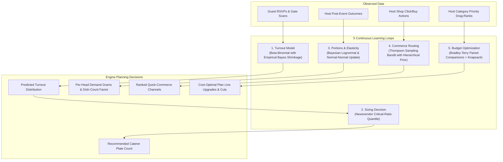

# Hostora

**Confirmed headcount in, a priced and diet-safe food & shopping plan out — with zero guesswork.**

[](https://github.com/satabartosarkar123/hostora/actions/workflows/ci.yml)


## Live Demo

Open `/app/login` and click **Try demo** (or run `make seed && make run` locally at `http://localhost:8000/app/login`).

## Why It Exists

Indian hosts routinely buy catering plates and supplies for a rough guess instead of a verified count, leading to 10–20% wedding food waste and avoidable overspending. Guests rarely install apps or create accounts just to reply to an invitation. Hostora gives each household a unique code and link that works without login or JavaScript, predicts real turnout (`low` – `likely` – `high`, recommending `p80` plates), and generates a priced food and shopping plan strictly governed by the host's dietary and faith rules.

*Note: Catalog consumption rates marked `seed-unvalidated` are illustrative development numbers and should be replaced with caterer-validated numbers before any real event.*

## Features

- **Frictionless Guest RSVP:** Unique household link and 10-char Crockford Base32 code (`XXXXX-XXXXX`), per-function attendance, adult/child steppers, meal split (`veg` / `jain` / `non_veg`), dietary rules, allergies, `.ics` calendar download, and `< 150 KB` page weight.
- **Live Host Dashboard:** Real-time Server-Sent Events (SSE) turnout counter, P80 plate recommendations, CSV household import, and 1-tap WhatsApp invitations.
- **Safety-First AI Planner:** Groq -> Gemini -> deterministic template fallback chain. LLMs propose catalog IDs only; `hostora.engine` enforces closed-world dietary rules (`halal`, `jain`, `pure_veg`, `no_beef`, `no_pork`, `no_alcohol`, `eggless`, `vegan`), computes quantities (`Q = (adults*per_adult + children*per_child) * k^-alpha * (1 + buffer)`), rounds to packs via unbounded knapsack, fits the budget, and attaches quick-commerce/food/e-commerce links based on `days_left`.
- **Offline QR Venue Gate:** Ed25519-signed passes verified offline in the browser via Service Worker + IndexedDB, with idempotent batch scan synchronization and duplicate pass detection.

## How the AI Is Kept Safe

```
Host Brief ──► PII Redactor ──► LLM Router (Groq / Gemini / Template)
                                       │
                                       ▼
                    Runtime Grounding against Cited Evidence
                    (Open Food Facts, Wikidata, OSM Taginfo, Web)
                                       │
                                       ▼
                     apply_rules() (Closed-World + Semantics)
                                       │
                                       ▼
               Learned Quantities, Sizing & Budget Optimization
```

## How Hostora Learns

Every numerical quantity in Hostora adapts from observed outcomes rather than hard-coded magic numbers, governed by 5 closed-loop Bayesian and decision-theoretic models:



1. **Turnout Model (`engine/turnout.py`):** Beta-binomial update per `(state, event_type, function_kind, reply_status)` segment. Groups shrink toward regional state priors using empirical-Bayes pooling.
2. **Newsvendor Plate Sizing (`engine/newsvendor.py`):** Calculates cost-minimizing order quantity at quantile $q^* = \frac{c_{\text{short}}}{c_{\text{short}} + c_{\text{waste}}}$ derived directly from the host's catering risk slider (1–10).
3. **Portions & Elasticity (`engine/bayes.py`, `engine/portions.py`):** Log-normal Bayesian updating for single-dish serving sizes and normal-normal updating for dish-count elasticity $\alpha$ ($Q \propto k^{-\alpha}$).
4. **Commerce Routing Bandit (`engine/bandit.py`):** Contextual Thompson sampling across shop channels (Zepto, Blinkit, Instamart, Amazon) with hierarchical Beta priors, naturally balancing exploration of new vendors with exploitation of high-fulfillment shops.
5. **Budget Preferences (`engine/preferences.py`):** Bradley-Terry paired comparison model inferred from host category rank drag-and-drop orders, maximizing expected satisfaction under knapsack budget constraints.

### Learning CLI Commands

```bash
uv run hostora learn          # Nightly idempotent learning job (fits all models)
uv run hostora backtest       # Rolling-origin evaluation comparing models with baseline
uv run hostora insights       # Live status, sample size (n), basis, and values for every quantity
```

## Architecture

See [docs/architecture.md](docs/architecture.md) and the Architecture Decision Records in `docs/adr/`:
- [ADR 0001: FastAPI Modular Monolith](docs/adr/0001-fastapi-modular-monolith.md)
- [ADR 0002: Postgres (Neon) Single Source of Truth](docs/adr/0002-postgres-single-source-of-truth.md)
- [ADR 0003: Free-Tier Hosting on Render + Neon](docs/adr/0003-hosting-render-neon.md)
- [ADR 0004: Scheduled Jobs via GitHub Actions Cron](docs/adr/0004-scheduled-jobs-github-actions.md)
- [ADR 0005: Safety-First LLM Chain & Deterministic Filter](docs/adr/0005-llm-chain-and-deterministic-safety.md)
- [ADR 0006: Realtime Updates via SSE](docs/adr/0006-realtime-sse-broadcaster.md)
- [ADR 0007: Modern Python Tooling Stack](docs/adr/0007-python-tooling-stack.md)
- [ADR 0008: Offline Ed25519 Signed Gate Passes](docs/adr/0008-offline-ed25519-gate-passes.md)

## Engineering Highlights

- **Pure Deterministic Engine (`src/hostora/engine/`):** Property-tested with Hypothesis (`tests/engine/test_engine.py`) guaranteeing zero forbidden tags survive filtering and pack totals always cover need with bounded waste.
- **Row-Locked Idempotent RSVPs (`src/hostora/services/rsvp.py`):** `SELECT ... FOR UPDATE` on the household row + `(scope, key)` idempotency hash verification in a single transaction.
- **PII Redaction Guard (`src/hostora/planner/redact.py`):** Strips phone numbers, emails, URLs, and blocks prompts containing household display names before any external LLM call.
- **Offline Ed25519 Verification (`src/hostora/engine/passes.py` & `static/js/gate/`):** Identical binary payload verification in Python (`cryptography`) and browser (`@noble/ed25519`).
- **Monte Carlo Waste Simulator (`src/hostora/engine/simulate.py`):** Quantifies plates saved vs naive ordering across 10,000 synthetic events.

## Metrics

Every metric below is reproducible via the commands in [docs/metrics.md](docs/metrics.md):

| Metric | Result | Command |
| --- | --- | --- |
| Synthetic waste reduction (`events=10000`, `seed=7`) | **8.41%** mean over-ordered vs **74.92%** baseline (**37.59** plates saved / 100 invited) | `uv run hostora simulate --events 10000 --seed 7` |
| Grounded safety evals (`337` cases across 8 regions/faiths) | **0** unsafe auto-approvals, **0** PII leaks | `uv run pytest tests/evals -m "not llm_live"` |
| Learning loop backtests (`200` synthetic events) | **81.5%** empirical coverage (80% CI), **-4.3%** pinball loss | `uv run pytest tests/simulation/test_learning_loops.py` |
| Locust load test (`10` concurrent users) | **200 reqs**, p50 **430 ms**, **0.00%** error rate | `uv run python scripts/run_locust.py` |
| Guest invite page transfer weight | **6.22 KB** (budget ≤ 150 KB) | `uv run python scripts/check_page_weight.py` |
| Accessibility (`axe-core` on invite, done, dashboard, gate) | **0** serious/critical violations | `uv run pytest tests/e2e/test_a11y.py` |
| Test coverage | **98%** overall (≥ 85%), **97%** `engine/` (≥ 95%) | `make check` |

## Quick Start (Under 10 Commands)

```bash
uv sync --all-groups
cp .env.example .env
uv run hostora gen-keys >> .env
make db-up && docker compose exec db createdb -U hostora hostora_test
make migrate
make seed
make check
make run
```

**Secret Rotation Notes:**
- Rotating `TOKEN_HMAC_SECRET` invalidates previously shared guest invitation links and gate links.
- Rotating `PASS_SIGNING_KEY` (and `PASS_PUBLIC_KEY`) invalidates previously issued QR gate passes.

## Privacy by Design

- Phone numbers are encrypted at rest with AES-256-GCM (`PHONE_ENC_KEY`) and never exposed in plain text on tables or logs.
- IP addresses are never stored raw; rate-limiting buckets use truncated HMAC-SHA256 hashes.
- No guest names, phone numbers, or unredacted briefs are ever sent to LLMs.
- Dietary and faith preferences are shown only as aggregate counts to hosts/caterers and never appear on the gate scanner.
- Personal household data is automatically purged 90 days after the last function (`retention` cron job), and hosts can delete their account and events immediately via `DELETE /v1/me`.

## Roadmap & License

- **M9 Roadmap:** LightGBM/HistGradientBoosting quantile turnout model (`ml/`), multi-instance `LISTEN/NOTIFY` broadcaster, WhatsApp delivery receipts, ONDC/Swiggy partner integration, and Android Trusted Web Activity build.
- **License:** [MIT](LICENSE)
